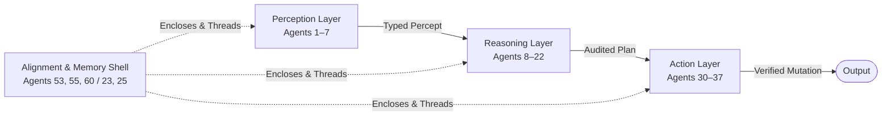

# Agent Architecture Patterns: The 60-Pattern Capability-Led Framework

Systematically match, evaluate, and compose advanced architectural patterns for autonomous systems based on *The AI Agent Engineer's Guide: 60 Patterns for Building Autonomous Systems* (Vahe Aslanyan).

---

## 1. Core Philosophy

Discard domain-centric taxonomies ("coding agent", "legal agent", "finance agent"). A medical agent and a code-review agent are cosmetically different in prompts and tools, but execute identical composite architectural patterns: document layout parsing, hierarchical goal decomposition, episodic memory lookup, self-consistency voting, hash provenance citation, human escalation boundaries, and two-phase side-effect auditing.

- **Agents as Software Artifacts**: Defined strictly by **input/output contracts**, internal **control loops**, and external **side effects**. No cognitive metaphors.
- **The 8 Capabilities**: Perception (1–7), Reasoning (8–15), Planning (16–22), Memory (23–29), Tool Use (30–37), Coordination (38–45), Learning (46–52), Alignment (53–60).
- **The 3-Tier Pattern Stack**: Perception Layer $\to$ Reasoning Layer $\to$ Action Layer, enclosed by Alignment (Off-Switch, Constitution, Provenance) and backed by Memory (Working, Episodic).

---

## 2. Two Operating Modes: Fast Triage vs. Full Spec

Adapt immediately to the user's scope. **Never force a full spec on a targeted question.**

```text
┌────────────────────────────────────────────────────────────────────────┐
│ Is the user asking a targeted question, comparison, or triage?        │
│   ├── YES ──► MODE A: FAST TRIAGE (Direct answer, no ceremony)        │
│   └── NO  ──► MODE B: FULL SYSTEM SPEC (End-to-end system design)     │
└────────────────────────────────────────────────────────────────────────┘
```

### Mode A: Fast Triage / Targeted Questions
Use when the user asks a specific question (*"Should I use ReAct or Plan-Then-Execute?"*, *"How do I stop tool selection from blowing up tokens?"*, *"What pattern handles ungrounded citations?"*).

- **Format**: Concise, direct answer first.
- **Components**:
  1. **Direct Recommendation**: The exact pattern name(s) and number(s).
  2. **The Trade-Off (Table)**: 2–3 rows comparing the chosen pattern against the obvious alternative.
  3. **The Failure Mode**: The single biggest thing that breaks in production and how to fix it.
  4. **Optional Micro-Diagram**: A minimal 3-to-4 node Mermaid diagram only if visual flow clarifies the choice.
- **Zero Ritual**: Skip the Context Matrix, skip the 8-capability table, skip the multi-page breakdown.

### Mode B: Full System Specification
Use when architecting an entire autonomous system from scratch or reviewing a comprehensive system design.

- **Workflow**:
  1. **Step 1: The Context Matrix** (Goal, Regulatory Mandates, Mistake Risk, Evaluation Signal).
  2. **Step 2: The Capability Profile Table** (Section 13.1 contract mapping active capabilities).
  3. **Step 3: High-Level Mermaid Topology** (Clean candidate view, 4–6 nodes max).
  4. **Step 4: Cross-Pattern Failure & Alignment Guardrails** (Interaction failure modes & mitigations).

---

## 3. Minimalist Diagram Standard (Design Candidate View)

**Rule of Parsimony**: Keep design diagrams clean, legible in 3 seconds, and unencumbered by visual clutter.
- **Max 4–6 core nodes**.
- **No deeply nested subgraphs** unless strictly showing an outer security boundary.
- **Label only the primary data shape** flowing between arrows.

#### The Standard 4-Block Macro Flow


---

## 4. Pattern Catalog Index (Agents 1–60)

Consult `references/catalog-60-patterns.md` for full definitions:
- **Perception (1–7)**: 1 Multimodal Grounding, 2 Doc Layout, 3 Sensor-Fusion, 4 Anomaly Spotter, 5 Visual Decomp, 6 Ambient Context, 7 Schema-Inference.
- **Reasoning (8–15)**: 8 CoT Auditor, 9 Counterfactual, 10 Analogical, 11 Constraint-Sat, 12 Causal Graph, 13 Symbolic-Neural, 14 Belief Updater, 15 Self-Consistency.
- **Planning (16–22)**: 16 Hierarchical Decomp, 17 ReAct, 18 Tree-of-Thought, 19 Plan-Execute, 20 Replanner, 21 Schedulers, 22 Goal-Regression.
- **Memory (23–29)**: 23 Episodic Buffer, 24 Semantic Curator, 25 Working-Memory, 26 Forgetting-Policy, 27 Memory-of-Self, 28 Vector Curator, 29 Persistent Identity.
- **Tool Use (30–37)**: 30 Tool Selector, 31 API Adapter, 32 Sandbox, 33 Shell Operator, 34 Browser Driver, 35 DB Synthesizer, 36 FS Curator, 37 Side-Effect.
- **Coordination (38–45)**: 38 Dispatcher, 39 Debate Mod, 40 Consensus, 41 Orchestrator, 42 HITL Liaison, 43 Negotiation, 44 Auctioneer, 45 Supervisor.
- **Learning (46–52)**: 46 Feedback Loop, 47 Reflection, 48 Skill Library, 49 Curriculum, 50 Few-Shot Tuner, 51 Distillation, 52 Active Learner.
- **Alignment (53–60)**: 53 Constitution, 54 Refusal Calibrator, 55 Provenance Tracker, 56 Red-Team Auditor, 57 Privacy-Preserving, 58 Explainer, 59 Drift-Detector, 60 Off-Switch.

Consult `references/workflow-and-topologies.md` for reference compositions and failure analysis.
